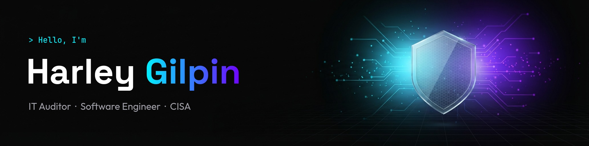
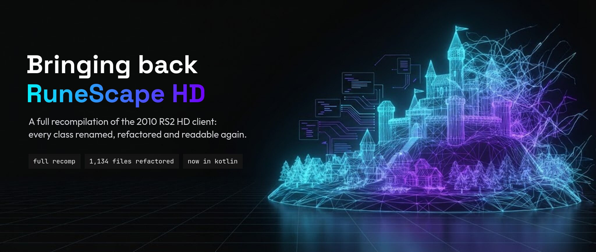

  
  
  
  

<samp>&gt; hello, i'm harley gilpin</samp>

**Building the future of web experiences.** I craft secure, futuristic digital solutions at the intersection of cybersecurity, software engineering, and digital marketing. By day I'm an IT Auditor (CISA) at Armanino LLP. After hours I build websites, open-source tools, and home-lab experiments.

 

<samp>&gt; flagship project</samp>

### Restoring a classic online game

RuneScape is one of the longest-running online games in the world, and fans keep its 2011 era alive on community-run servers like [2011Scape](https://2011.rs). The catch: the game's original software was deliberately scrambled before release. Thousands of pieces were given meaningless names like `a`, `ba` and `oa`, which made it nearly impossible to fix or improve.

This project is a full recomp (recompilation) of the 2010 RS2 HD client, the high-definition version of RuneScape. I took on the job of untangling it, start to finish.

- **Made it readable.** Renamed and reorganized 1,134 source files into clearly named sections for graphics, networking, game data and more.
- **Converted it to Kotlin.** Rewrote the code in Kotlin, laying the groundwork for future versions that run on phones and in web browsers.
- **Brought it up to date.** It runs on current versions of Java, with a simple launcher that connects to any compatible server.
- **Made it nicer to play.** Optional extras like smoother frame rates, sharper graphics, screen scaling, tile markers and on-screen XP drops.
- **Wrote it all down.** Guides that help new contributors find their way around the code.

**Credits.** This work stands on the shoulders of the RuneScape private server community on Rune-Server: **Pazaz** for the initial deobfuscation and its annotations, **Scu11** for his 667 client reference, and **Steven and the Darkan team** for their refactoring of the 727 client.

  
  

 

<samp>&gt; security first</samp>

### Cybersecurity Expertise

| | |
|:--|:--|
| **IT Audit & Compliance** SOC 1 and SOC 2 audits grounded in NIST framework principles. | **Security Architecture** Defense-in-depth and zero-trust, designed in from the ground up. |
| **Vulnerability Assessment** Finding weaknesses before attackers do, with clear steps to fix them. | **CISA Certified** ISACA-certified IT auditor with a compliance-first mindset on every project. |

 

<samp>&gt; what i do</samp>

### Services Offered

**Web Development** · **UI/UX Design** · **SEO & Marketing** · **Automation**. End-to-end help, from secure web apps to growing your online presence. [See services & pricing →](https://harleygilpin.com)

  

  
  

---

### Let's secure your digital future.

Free consultation · Fast response · No commitment

